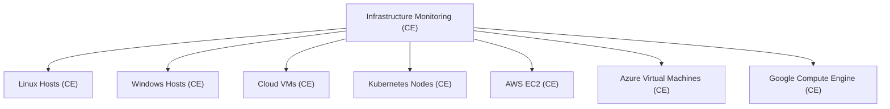

# O11y Infrastructure Monitoring (CE) content pack

> Part of the **O11y Community Edition** series: free ITSI content packs built on Splunk Observability Cloud data and maintained by the community. Not an official Splunk product and not covered by Splunk support.

Basic platform monitoring in ITSI, with Splunk Observability Cloud as the data collector. Each platform gets its own entity type, service template and service, mirroring how Observability Cloud groups hosts: agent hosts by operating system, cloud VMs and Kubernetes nodes, and agentless cloud instances. KPIs use a small set of metrics at 5-minute resolution, optionally combined with system log counts.

The pack is a clean sheet: it does not use or require the stock Splunk Observability Cloud, Unix/Linux or Windows content packs. It replaces the infrastructure part of the Content Pack for Splunk Observability Cloud and should not run alongside it (see [Conflicts](#conflicts-with-the-content-pack-for-splunk-observability-cloud)). Metrics reach Splunk through the Splunk Infrastructure Monitoring Add-on and the companion [`TA-o11y-sim-streams`](../../add-ons/TA-o11y-sim-streams) (1.2.0 or later).

Package: `DA-ITSI-CP-CUST-6af71b4317cfae6529db68e5_1_0_0.tar.gz`, attached to the `infrastructure-monitoring-v1.0.0` release.



Services and templates end in (CE), for Community Edition, and entity types start with O11y, so none shares a title with stock content packs. Otherwise, names follow the Observability Cloud navigator and dashboard groups.

The pack ships only this tree. To group it with the other O11y Community Edition packs, add Infrastructure Monitoring (CE) as a dependency of a top-level service of your own.

## Requirements

- Splunk ITSI 5.0.x (built and tested on 5.0.2). ITSI 4.x is not tested yet.
- Splunk Infrastructure Monitoring Add-on (`splunk_ta_sim`), connected to your Observability Cloud org.
- `TA-o11y-sim-streams` 1.2.0, writing to the `sim_metrics` metrics index, with the streams you need enabled:

| Stream | Feeds | Source in Observability Cloud |
|---|---|---|
| `OS_Hosts` | Linux Hosts (CE), Windows Hosts (CE), Cloud VMs (CE), Kubernetes Nodes (CE) | Splunk OTel Collector host metrics (default agent configuration) |
| `AWS_EC2` | AWS EC2 (CE) | AWS integration (CloudWatch `AWS/EC2`) |
| `Azure_VM` | Azure Virtual Machines (CE) | Azure integration (`Microsoft.Compute/virtualMachines`) |
| `GCP_Compute` | Google Compute Engine (CE) | Google Cloud integration (Compute Engine) |

- Optional, for the log KPIs: Linux system logs as `sourcetype=journald` and the Windows System event log (`WinEventLog` or `XmlWinEventLog`, as collected by the Splunk Add-on for Microsoft Windows).

The AWS EC2 objects are tested against live data. The Azure Virtual Machines and Google Compute Engine objects follow the metric names of the `splunk_ta_sim` sample inputs and are not tested against live data yet.

## Conflicts with the Content Pack for Splunk Observability Cloud

This pack replaces the infrastructure part of the stock Content Pack for Splunk Observability Cloud (`DA-ITSI-CP-splunk-observability`, shipped with the Splunk App for Content Packs). Do not run both for the same hosts and instances.

| Conflict | Stock pack | This pack | Effect when both are installed |
|---|---|---|---|
| Services | Infrastructure Monitoring, OS Hosts, AWS EC2, Azure VM, GCP Compute Engine | Infrastructure Monitoring (CE) and its seven (CE) services | No title clash, but two trees monitor the same hosts and instances |
| Host entities | OS Hosts, identifier `ITSIUniqueId` | O11y Linux Host and the other agent types, identifiers `host_fqdn`, `host_name`, `host_short` | Two entities per host |
| EC2 entities | AWS EC2, identifier `InstanceId` | O11y AWS EC2 Instance, identifier `aws_instance_id` | Two entities per instance |
| Azure and GCP entities | Azure VM (`ITSIUniqueId`), GCP Compute Engine (`gcp_id`) | `azure_resource_id`, `gcp_instance_id` | Two entities per instance |
| SIM inputs | `SAMPLE_OS_Hosts`, `SAMPLE_AWS_EC2`, `SAMPLE_Azure`, `SAMPLE_GCP` | `OS_Hosts`, `AWS_EC2`, `Azure_VM`, `GCP_Compute` | Both write to `sim_metrics` without mixing (different stream labels), but double the Observability Cloud API usage |

The stock pack's APM, RUM, Synthetics, AWS Lambda, Azure Functions, GCP Cloud Functions and container content does not overlap with this pack and can stay. To replace only its infrastructure part:

1. Disable the stock import searches `ITSI Import Objects - Get_OS_Hosts`, `- Get_SIM_AWS_EC2`, `- Get_SIM_Azure_VM` and `- Get_SIM_GCP_Compute`, and the `SAMPLE_OS_Hosts` and `SAMPLE_AWS_EC2` inputs. `SAMPLE_Azure` and `SAMPLE_GCP` also feed the stock Functions services: disable them only if you drop those too.
2. Delete the stock services OS Hosts, AWS EC2, Azure VM and GCP Compute Engine, then their entities of type OS Hosts, AWS EC2, Azure VM and GCP Compute Engine. The stock Infrastructure Monitoring service and its AWS, Azure, GCP and My Data Center Hosts rollups still hold the Lambda, Functions and container services: keep them, or move those services under Infrastructure Monitoring (CE) and delete the stock rollups.
3. Install this pack.

## Install

1. Install `TA-o11y-sim-streams` on the search head and enable the streams you need. Leave `org_id` blank to use the add-on's default account, or set it.
2. Check that metrics arrive:

   ```spl
   | mstats count(_value) where index=sim_metrics metric_name=* (sf_streamLabel=oshost_* OR sf_streamLabel=awsec2_* OR sf_streamLabel=azvm_* OR sf_streamLabel=gcpvm_*) by sf_streamLabel
   ```

3. Install the content pack app (Apps → Install app from file), then install the pack from ITSI → Configuration → Data integrations → Content library.
4. Review the macros (next section), at least `infmon_indexes`, `infmon_linux_log_indexes` and `infmon_windows_log_indexes`.
5. Run the `INFMON Discover Entities - *` searches once to create the entities. They then run hourly.

## Entity discovery and macros

Every discovery search reads its scope, classification and fields from macros, so you can adapt the pack without editing searches. Edit them in Settings → Advanced search → Search macros, in the app of the content pack.

| Macro | Default | Purpose |
|---|---|---|
| `infmon_indexes` | `index=sim_metrics` | Metrics index written by the SIM add-on |
| `infmon_host_name` | FQDN, as sent | Entity title and KPI split field for agent hosts (see Host name format) |
| `infmon_host_filter` | `search *` | Scope of agent host discovery, on the platform dimensions. Example: `search k8s.cluster.name!="dev-*"` |
| `infmon_platform` | see below | Platform classification of agent hosts |
| `infmon_agent_inventory` | | One row per agent host with platform and inventory fields; uses the four macros above. Hosts that send no OTel host metrics (`system.network.io`) are skipped |
| `infmon_aws_ec2_filter`, `infmon_azure_vm_filter`, `infmon_gcp_vm_filter` | `search *` | Scope of cloud instance discovery. Example: `search aws_region=eu-*` |
| `infmon_aws_ec2_inventory`, `infmon_azure_vm_inventory`, `infmon_gcp_vm_inventory` | | One row per cloud instance; edit to change titles or add fields |
| `infmon_linux_log_indexes` | `index=linux` | Indexes holding Linux system logs |
| `infmon_windows_log_indexes` | `index=wineventlog` | Indexes holding the Windows System event log |
| `infmon_log_indexes` | both macros above | Every system log index, for ad-hoc searches; set the two platform macros instead |
| `infmon_linux_logs` | `journald` events | Linux log events and their `log_error` and `svc_failure` flags |
| `infmon_windows_logs` | System event log | Windows log events and their `log_error` and `svc_failure` flags |
| `infmon_log_host` | lowercase short name of `host` | Maps the log `host` field to the `host_short` entity alias |

`infmon_platform` classifies each agent host from its OTel resource attributes. The first match wins; hosts classified as `other` (for example ECS tasks) are not discovered.

| Order | Condition | Platform | Entity type |
|---|---|---|---|
| 1 | `k8s.node.name` is set | `kubernetes` | O11y Kubernetes Node |
| 2 | `cloud.platform` is `aws_ec2`, `azure_vm` or `gcp_compute_engine` | `cloud_vm` | O11y Cloud VM |
| 3 | `os.type` is `windows` | `windows` | O11y Windows Host |
| 4 | `os.type` is `linux` | `linux` | O11y Linux Host |

To keep cloud VMs with their operating system instead, remove the second condition. The OTel collector sets `cloud.*` attributes only when the `resourcedetection` processor runs a cloud detector.

### Entity fields

| Entity type | Identifiers (merge field first) | Info fields |
|---|---|---|
| Linux Host, Windows Host | `host_fqdn`, `host_name`, `host_short` | `platform`, `os_type`, `cpu_count`, `memory_total_gb` |
| Cloud VM | `host_fqdn`, `host_name`, `host_short` | as above, plus `cloud_provider`, `cloud_platform`, `cloud_region`, `instance_type`, `host_id` |
| Kubernetes Node | `host_fqdn`, `host_name`, `host_short` | `platform`, `os_type`, `k8s_cluster`, `cloud_provider`, `cloud_region`, `cpu_count`, `memory_total_gb` |
| AWS EC2 Instance | `aws_instance_id` | `aws_region`, `aws_account_id` |
| Azure Virtual Machine | `azure_resource_id` | `azure_region`, `resource_group`, `subscription_id` |
| Google Compute Engine Instance | `gcp_instance_id` | `project_id`, `zone` |

Every entity also carries the info field `etype`, which the service entity rules match. Metric KPIs split agent hosts on `host_name`; log KPIs split on `host_short`. No identifier contains `computationId` or `jobId`, so restarting a SIM input never creates new entities.

An EC2 instance that runs the OTel collector appears twice: as a Cloud VM (agent metrics) and as an AWS EC2 Instance (CloudWatch metrics). The two entities are deliberately separate; the Cloud VM's `host_id` holds the instance ID.

Discovery looks back 4 hours. Entities of hosts that stop reporting stay in ITSI, so short-lived Kubernetes nodes accumulate: enable an entity retirement policy (Configuration → Entity management) for the O11y entity types.

## What is included

| Object | Names |
|---|---|
| Service | Infrastructure Monitoring (CE), the rollup, depending on the health score of the seven services below |
| Services and templates | Linux Hosts (CE), Windows Hosts (CE), Cloud VMs (CE), Kubernetes Nodes (CE), AWS EC2 (CE), Azure Virtual Machines (CE), Google Compute Engine (CE), each linked to the template of the same name |
| Entity types | O11y Linux Host, O11y Windows Host, O11y Cloud VM, O11y Kubernetes Node, O11y AWS EC2 Instance, O11y Azure Virtual Machine, O11y Google Compute Engine Instance: vitals, a metrics drilldown and an entity health dashboard each |
| Entity health dashboards | `infmon_entity_<platform>` (Dashboard Studio), opened from the entity in Service Analyzer and Entity Management |
| KPI base searches | Agent Hosts, System Logs, AWS EC2, Azure Virtual Machines, Google Compute Engine |
| Discovery searches | `INFMON Discover Entities - <service>`, hourly |
| Macros | the 17 `infmon_*` macros above |

## KPIs

All KPIs run every 5 minutes over one 5-minute bucket. Agent host data arrives within 2 minutes (the `OS_Hosts` stream drops points more than 60 seconds late instead of waiting for them), so those KPIs wait 90 seconds. Cloud integration data reaches Observability Cloud several minutes late, so the cloud KPIs wait 10 minutes.

### Agent hosts

| KPI | Source | Per host | Service | Thresholds (medium / high / critical) | Importance | Services |
|---|---|---|---|---|---|---|
| Disk Used % | `disk.summary_utilization` | max | avg | 80 / 90 / 95 | 9 | all |
| Memory Used % | `memory.utilization` | avg | avg | 85 / 90 / 95 | 8 | all |
| CPU Utilization % | `cpu.utilization` | avg | avg | 80 / 90 / 95 | 7 | all |
| Load per CPU (5m) | `system.cpu.load_average.5m` / `cpu.num_processors` | avg | avg | 1 / 1.5 / 2 | 5 | not Windows |
| Network Errors | `system.network.errors` | sum | sum | 1 / 100 / - | 5 | all |
| Paging Operations /s | `system.paging.operations` | avg | avg | none | 3 | all |
| Disk Operations /s | `system.disk.operations` | avg | sum | none | 1 | all |
| Disk I/O (B/s) | `system.disk.io.total` | avg | sum | none | 1 | all |
| Network In, Network Out (B/s) | `system.network.io` by direction | avg | sum | none | 1 | all |
| Error Log Events | `infmon_linux_logs`, `infmon_windows_logs` | sum | sum | 10 / 50 / - | 5 | not Kubernetes |
| Service Failures | `infmon_linux_logs`, `infmon_windows_logs` | sum | sum | 1 / 3 / - | 6 | not Kubernetes |

- Disk Used % is the used share of local filesystem capacity. Hosts that do not report `disk.summary_utilization`, including many Kubernetes nodes, show N/A at info severity, which does not affect the health score.
- Load is divided by the CPU count, so one threshold fits a 2-core VM and a 256-core server. Windows does not report load average.
- Error Log Events counts journald events at priority `err` or worse and Windows System events of type Error or Critical, per 5 minutes.
- Service Failures counts systemd `Failed with result`, `Main process exited, code=killed|dumped` and `Scheduled restart job` messages, and Service Control Manager events 7023, 7024, 7031 and 7034.
- Hosts without system logs show N/A for the log KPIs. Hosts whose logs only contain informational events show 0.
- Throughput, I/O and paging have no static thresholds because no value fits every host; enable adaptive thresholds per service once two weeks of data exist.

### Cloud instances

| KPI | AWS EC2 | Azure Virtual Machines | Google Compute Engine | Thresholds | Importance |
|---|---|---|---|---|---|
| CPU Utilization % | `CPUUtilization` | `Percentage CPU` | `instance/cpu/utilization` × 100 | 80 / 90 / 95 | 7 |
| Network In, Network Out (B/s) | `NetworkIn`, `NetworkOut` | `Network In`, `Network Out` | `instance/network/*_bytes_count` | none | 1 |
| Disk or EBS Operations /s | `EBSReadOps` + `EBSWriteOps` | `Disk Read/Write Operations/Sec` | `instance/disk/*_ops_count` | none | 1 |
| Status Check Failed | `StatusCheckFailed` (maximum) | | | critical at 1 | 9 |
| VM Unavailable | | 1 when `VmAvailabilityMetric` is below 1 | | critical at 1 | 9 |
| Available Memory (GB) | | `Available Memory Bytes` | | none | 3 |

Byte and operation counts are 5-minute totals from the stream, divided by 300 in the base search.

### Health score

- Importance is ITSI's KPI weight in the service health score (1 to 11). Disk, memory and CPU drive the score; throughput and I/O are shown but barely weigh.
- The health score is calculated per entity (`is_healthscore_calculate_by_entity_enabled`), so one saturated host lowers the service score without averaging it away.
- Services without entities (for example Azure Virtual Machines (CE) when the Azure stream is off) show N/A and do not affect the rollup.

## Host name format

`infmon_host_name` sets `host_name` from `host.name`. Discovery, the base search and the vitals all use it, so entities and KPI results always agree.

| Format | Macro definition | `web01.example.com` becomes |
|---|---|---|
| FQDN, as sent (default) | `eval host_fqdn='host.name', host_name='host.name'` | `web01.example.com` |
| Short name | `eval host_fqdn='host.name', host_name=if(match('host.name', "^\d{1,3}(\.\d{1,3}){3}$"), 'host.name', replace('host.name', "\..*$", ""))` | `web01` |

Short names keep IPv4 addresses whole. Discovery merges on `host_fqdn`, so switching creates no new entities: existing entities gain the new `host_name` value as an extra identifier and keep their title. Check that short names are unique across domains before switching:

```spl
| mcatalog values(host.name) as fqdn where index=sim_metrics sf_streamLabel=oshost_cpu | mvexpand fqdn
| eval short=replace(fqdn, "\..*$", "") | stats dc(fqdn) as n values(fqdn) as fqdn by short | where n>1
```

The same check applies to `host_short`, which the log KPIs use whatever the format.

## Narrower services

Each platform service contains every entity of its type. For per-application, per-cluster or per-team services, create services from the platform's template (Configuration → Services → Create service → Create from template) and add an entity rule, for example on `k8s_cluster`, `cloud_region` or an info field your CMDB import adds. Linked services receive template changes; edit KPIs and thresholds on the template, not on the services.

## Troubleshooting

| Symptom | Fix |
|---|---|
| No `oshost_*` or cloud series in `sim_metrics` | Check that the add-on's account points at the right Observability Cloud org, or set `org_id` on the input. See the TA troubleshooting for `ANALYTICS_INTERNAL_ERROR` after re-enabling an old input |
| A host is in the wrong platform service | Check its `os.type`, `k8s.node.name` and `cloud.platform` attributes in Observability Cloud, or adjust `infmon_platform` |
| Log KPIs stay N/A | Check `infmon_linux_log_indexes` and `infmon_windows_log_indexes`, and that `host_short` (lowercase short name) matches the log `host` field: `` `infmon_linux_logs` | `infmon_log_host` | stats count by host_short `` |
| Cloud KPIs are N/A although the stream runs | Cloud data can arrive more than 10 minutes late. Raise the monitoring lag of the cloud base search |
| Duplicate entities for one host | Check that no other content pack or import creates entities with a `host_name`, `host_fqdn` or `host_short` alias for the same hosts |
| Discovery succeeds but creates no entities after a reinstall | Delete the search's records from the KV collections `itsi_import_objects_cache` and `itsi_bulk_import_entities_status_cache`, then run it again |

## Authoring tools

[`tools/deploy_infrastructure_monitoring.py`](tools/deploy_infrastructure_monitoring.py) creates or updates every object of the pack over REST, using the REST helpers in [`tools/itsi_pack.py`](../../tools/itsi_pack.py).

| Option | Effect |
|---|---|
| `--print-spl` | Print every macro, base search and discovery search, then exit |
| `--host-format fqdn\|short` | Set the host name macro |
| `--reset-macros` | Overwrite existing macros with the defaults (otherwise existing macros are kept) |
| `--only linux,windows,...` | Deploy only some platforms |

```sh
export ITSI_URL=https://your-search-head:8089 ITSI_TOKEN=<bearer token>
python3 tools/deploy_infrastructure_monitoring.py
```

Set `ITSI_INSECURE=1` only for management ports with self-signed certificates. Read the token from a secret store or environment; do not put it in files.

See [CHANGELOG.md](CHANGELOG.md) for release notes.
